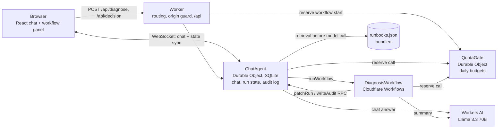
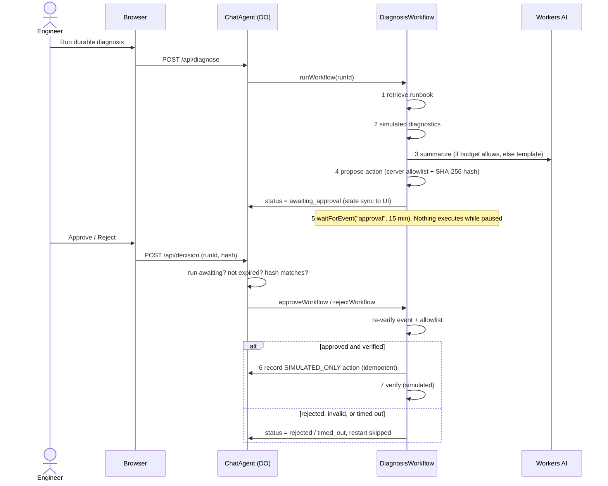

# Architecture

## Components

## Diagnosis workflow with the approval gate

## State and where it lives

| Data | Location | Notes |
|---|---|---|
| Chat transcript | `ChatAgent` SQLite | restored on reconnect |
| Workflow run view | `ChatAgent` state (SQLite, synced to clients) | last 10 runs |
| Audit log | `ChatAgent` SQLite `audit_log` | mirrored to state (last 30) |
| Simulated actions | `ChatAgent` SQLite `simulated_actions` | primary key = run id |
| Workflow step results | Cloudflare Workflows durable storage | resumes after restart |
| Daily usage counters | `QuotaGate` SQLite | hashed client keys (pseudonymous, no raw IPs stored) |
